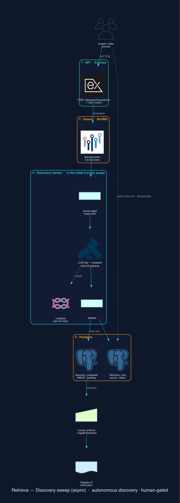

# Discovery connectors (RTV-91)

The **autonomous discovery agents** (AI-native roadmap, Pillar 1). Each connector sweeps a source
system (read-only) and **proposes** DORA third-party arrangements for the ICT apps in use — so shadow
IT surfaces itself into the Register of Information instead of being typed in by hand.

**Sources today:** **Okta** (enterprise IdP), **Authentik** (this platform's own IdP), **ERPNext**
(AP/ERP — RTV-92) and a **generic AI-ingestion source** (RTV-106 — upload/paste anything). The IdP
sources discover apps by *identity*; the ERP source discovers third parties by *spend* (the suppliers we
pay), so it catches shadow IT an IdP can't see; the generic source covers the long tail of systems with
no built-in connector. Adding a source is just a new client; the rails below are source-agnostic.

> **Scaling to real customers (not hand-built per vendor).** Okta/Authentik/ERPNext are the concrete
> connectors *this* deployment (ktayl) uses — reference implementations of the `DiscoverySource` /
> `DiscoveredApp` plug-in contract, not the product ceiling. A customer on Entra ID + SAP uses the same
> rails via: first-class connectors for the common systems · **standard-protocol connectors (SCIM/OData/
> generic REST — RTV-107, below)** · and the **generic AI-ingestion source (RTV-106, below)** as the
> universal fallback. The specific connectors are the high-value head of a long tail the AI covers.

## Tier-2: standard-protocol connectors (RTV-107)

The middle of the connector strategy: **one connector per _protocol_** replaces N per-vendor connectors
for the systems that conform. Most IdPs speak **SCIM**; SAP/Dynamics speak **OData**; many apps expose a
listable **REST** collection. Each is **config-driven** — no code change to onboard a conforming system —
delivered as a single JSON secret per protocol (platform secret convention / ESO), never in code. An
unset protocol `503`s (not configured); egress to the customer endpoint is gated by a scoped netpol
(deployment-side). All three reuse the identical async pipeline + provenance; where the protocol response
lacks a field, the LLM mapper fills the gap.

| Protocol | `source` | Records at (default) | Pagination | Typical systems |
|---|---|---|---|---|
| Generic REST | `rest` | config `recordsPath` (e.g. `data.items`) | `none` / `nextLink` (config path) | any listable REST collection |
| SCIM | `scim` | `Resources` | `startIndex`/`count` | Entra ID, Okta, Google (SCIM) |
| OData | `odata` | `value` | `@odata.nextLink` | SAP, Dynamics |

```bash
# configure (one JSON secret per protocol — ESO delivers it as env):
DISCOVERY_REST_CONFIG='{"baseUrl":"https://api.acme.com","listPath":"/v1/vendors","auth":{"type":"bearer","value":"<tok>"},"recordsPath":"data.items","mapping":{"id":"id","label":"name","service":"category"},"pagination":"nextLink","nextLinkPath":"links.next"}'
DISCOVERY_SCIM_CONFIG='{"baseUrl":"https://idp.acme.com","listPath":"/scim/v2/Users","auth":{"type":"bearer","value":"<tok>"}}'       # Resources/scim/displayName defaulted
DISCOVERY_ODATA_CONFIG='{"baseUrl":"https://sap.acme.com","listPath":"/odata/Suppliers","auth":{"type":"basic","value":"user:pass"},"mapping":{"label":"SupplierName"}}'

# run (same async rails → 202 { runId }, poll like any source):
curl -X POST https://<api>/api/v1/discovery/rest/run  -H "Authorization: Bearer <jwt>"
curl -X POST https://<api>/api/v1/discovery/scim/run  -H "Authorization: Bearer <jwt>"
curl -X POST https://<api>/api/v1/discovery/odata/run -H "Authorization: Bearer <jwt>"
```

**Auth types:** `bearer` (token) · `basic` (`"user:pass"`) · `apikey` (custom `header` + value) · `none`.
**Field mapping** (`mapping`) and `recordsPath`/`nextLinkPath` are **dot-paths** into the JSON response
(`a.b.c`). `mapping.label` (the human name) is required; `id` defaults to a synthesised stable id;
`service`/`spend` become `meta` hints for the mapper. Pagination is bounded by `maxPages` (default 10).

## Tier-3: generic AI-ingestion (RTV-106)

The **AI-native catch-all** for systems we have no built-in connector for. A customer **uploads a
CSV/XLSX export** (or **pastes a JSON array**) of their vendors / AP ledger / SSO app list; the LLM
**infers which columns** are the provider / service / spend / criticality — no hardcoded headers — and
the normalised apps flow through the **identical** pipeline (worker → mapper → dedup → inbox → confirm).
This is what makes discovery AI-native rather than a parser-per-format.

**How the mapping stays cheap + PII-light:** the LLM is called **once** on a small **sample** of rows to
infer the column mapping; that mapping is then applied **deterministically** (pure code) to every row —
the whole ledger is never sent to the model. Fail-safe: if the model is unavailable or unsure, a
header-name **heuristic** produces the mapping. The mapping call is Langfuse-traced via the gateway.

```bash
# 1. PREVIEW — infer the mapping + see a few normalised rows BEFORE committing (no run, no persistence):
curl -X POST https://<api>/api/v1/discovery/generic/preview -H "Authorization: Bearer <jwt>" \
  -F "file=@vendors.csv"
#   or paste JSON:
curl -X POST https://<api>/api/v1/discovery/generic/preview -H "Authorization: Bearer <jwt>" \
  -H 'Content-Type: application/json' -d '{"rows":[{"Supplier":"Acme","Annual Spend":"120000"}]}'
#   → 200 { rowCount, headers, mapping:{provider,service,spend,criticality,id}, confidence, usedFallback, sample }

# 2. RUN — normalise + enqueue the apps through the async pipeline → poll like any source:
curl -X POST https://<api>/api/v1/discovery/generic/run -H "Authorization: Bearer <jwt>" -F "file=@vendors.csv"
#   → 202 { runId, normalised, mapping, poll: "/api/v1/discovery/runs/<id>" }
```

**Guardrails:** upload ≤ 25 MB, rows capped (first `MAX_ROWS` = 500); the inferred mapping + confidence +
`usedFallback` are returned so a human can correct a mis-map (re-run with a pasted `mapping`-corrected set
or fix the headers). Provenance: each proposal records `source: generic` + the original row (`meta.sourceRow`).

**Governance rule they obey:** *autonomous discovery & drafting, never autonomous sign-off.* A
connector **never writes an arrangement**. It produces proposals in an **inbox**; a human confirms
each one into the Register (or dismisses it).

**Async (RTV-91c).** A sweep maps every app with a per-app LLM call, which exceeds the ingress 60s
timeout on a large estate. So the sweep runs as a **BullMQ job**: `POST …/run` enqueues it and returns
`202 { runId }`; the **discovery worker** runs the sweep off the request path and persists the result
to `discovery_runs` + the proposal **inbox** (`discovery_proposals`), which you poll.

## Flow (identical for every source)

[](../architecture/img/discovery-flow.svg)

*Generated from code — `docs/diagrams/discovery_flow.py` (mingrammer `diagrams`).*

*Governance holds end-to-end: the worker **drafts** proposals into the inbox; nothing reaches the
Register until a human **confirms** (filling the fields an IdP can't know).*

## Configure (each source optional; unset ⇒ `503 not configured`)

```
# Okta
OKTA_ORG_URL=https://your-org.okta.com
OKTA_API_TOKEN=<read-only SSWS token>

# Authentik (this platform's IdP)
AUTHENTIK_BASE_URL=https://auth.your-domain
AUTHENTIK_API_TOKEN=<read-only API token>

# ERPNext (AP/ERP — discovers third parties from Purchase-Invoice spend)
ERPNEXT_BASE_URL=https://erp.your-domain
ERPNEXT_API_KEY=<frappe api key>
ERPNEXT_API_SECRET=<frappe api secret>   # → Authorization: token <key>:<secret>
ERPNEXT_INVOICE_LOOKBACK_DAYS=365        # optional (default 365)
ERPNEXT_HOST_HEADER=erp.your-domain      # optional — split-horizon: dial an internal svc
                                         # (ERPNEXT_BASE_URL=http://erpnext.erp.svc…:8080) but send
                                         # Host=<site> so Frappe routes to the right site. Unset when
                                         # ERPNEXT_BASE_URL already is the site's own URL.
```

Tokens are runtime secrets — never committed.

## Run (async)

```bash
# 1. Trigger a sweep → 202 { runId }. dryRun=true previews (counts + inline proposals, no inbox/audit).
curl -X POST https://<api>/api/v1/discovery/authentik/run \
  -H "Authorization: Bearer <jwt>" -H 'Content-Type: application/json' -d '{}'
#   → { "ok": true, "data": { "runId": "…", "status": "queued", "poll": "/api/v1/discovery/runs/…" } }

# 2. Poll the run → status + proposals (inbox items for a real run; inline preview for a dry run).
curl -H "Authorization: Bearer <jwt>" https://<api>/api/v1/discovery/runs/<runId>

# 3. The inbox across runs:
curl -H "Authorization: Bearer <jwt>" "https://<api>/api/v1/discovery/proposals?status=pending"

# 4. Confirm a proposal into an arrangement (fill the fields the IdP can't know, esp. legalEntityName):
curl -X POST https://<api>/api/v1/discovery/proposals/<id>/confirm \
  -H "Authorization: Bearer <jwt>" -H 'Content-Type: application/json' \
  -d '{"proposal": {"legalEntityName": "Acme SA"}}'
#   or dismiss it:
curl -X POST https://<api>/api/v1/discovery/proposals/<id>/dismiss -H "Authorization: Bearer <jwt>"
```

`GET …/runs/:id` response:

```jsonc
{
  "ok": true,
  "data": {
    "run": { "id": "…", "source": "authentik", "status": "succeeded", "dryRun": false,
             "discovered": 42, "proposed": 18, "skippedCount": 1, "startedAt": "…", "finishedAt": "…" },
    "proposals": [
      { "id": "…", "status": "pending", "source": "authentik", "externalName": "Grafana",
        "proposal": { "providerName": "Grafana Labs", "ictServiceName": "Observability",
                      "businessFunctionName": "IT Operations", "legalEntityName": null,
                      "criticality": "important", "confidence": 0.8, "notes": "…" } }
    ]
  }
}
```

### Endpoints

| Method + path | What |
|---|---|
| `POST /api/v1/discovery/{okta,authentik,erpnext}/run` | enqueue a sweep → `202 { runId }` |
| `GET /api/v1/discovery/runs` | recent sweeps for the org |
| `GET /api/v1/discovery/runs/:id` | a run's status + its proposals |
| `GET /api/v1/discovery/proposals?status=&runId=` | the proposal inbox |
| `POST /api/v1/discovery/proposals/:id/confirm` | confirm → create the arrangement (body merges over the proposal) |
| `POST /api/v1/discovery/proposals/:id/dismiss` | drop a proposal |

## Provenance & dedupe

- **Provenance** rides alongside each proposal: `{ source, externalId, externalName }` — so a confirmed
  arrangement is traceable to its exact source record.
- **Dedupe** is two-layer: against providers already registered for the org (by normalised display
  name, before *and* after LLM mapping) and within a single sweep (by source app id + mapped provider).
- A non-dry run writes one `discovery.<source>.run` entry to the audit log (counts only, no PII).

## Design (source-agnostic rails)

| File | Role |
|---|---|
| `services/discovery/types.ts` | `DiscoveredApp` + `DiscoverySource` — the normalised shape every client emits |
| `config/okta.ts`, `config/authentik.ts`, `config/erpnext.ts` | per-source config (graceful "not configured") |
| `services/discovery/oktaClient.ts` | Okta `/api/v1/apps` lister (SSWS auth, `Link` pagination) |
| `services/discovery/authentikClient.ts` | Authentik `/api/v3/core/applications/` lister (Bearer, page-number pagination) |
| `services/discovery/erpnextClient.ts` | ERPNext `Purchase Invoice` AP lister (Frappe `token` auth, `limit_start` pagination) → aggregates by supplier (spend/count/last-date) |
| `services/discovery/appToProposal.ts` | LLM app→proposal mapper (reuses intake's pure `normalizeProposal`; LLM injectable) |
| `services/discovery/discoveryService.ts` | orchestrator — `runDiscovery({source})` + a `CLIENTS` registry; dedupe, dry-run, audit; collaborators injectable |
| `config/queue.ts` · `types/jobs.ts` | the `discoveryJobs` BullMQ queue + `DiscoveryJobData` (RTV-91c async) |
| `workers/discoveryWorker.ts` | the worker: runs the sweep in the caller's entity scope, persists run + inbox (`processDiscoveryJob` is injectable) |
| `db/schema/discoveryRuns.ts` · `discoveryProposals.ts` | the run-tracking table + the proposal inbox (+ enums) |
| `repositories/drizzle/DiscoveryRepository.ts` | run/inbox persistence (org-scoped reads, RTV-54 entity filter) |
| `modules/discovery/*` | `POST …/run` (enqueue) + the runs/proposals polling + confirm/dismiss endpoints |

All LLM calls go through the LiteLLM gateway (`purpose: 'analysis'`, `jsonMode`) and are Langfuse-traced.
Every collaborator (client, mapper, repo, audit, worker handler) is injectable, so the whole flow
unit-tests with no network, model, or DB (`tests/unittest/{okta,authentik}Client.unit.test.ts`,
`appToProposal.unit.test.ts`, `discoveryService.unit.test.ts`, `discoveryWorker.unit.test.ts`).

## Scheduling (repeatable · RTV-91d)

Besides the API trigger, the sweep can run on a **repeatable schedule**. Opt in with env (off by default):

```
DISCOVERY_SCHEDULE_ENABLED=true      # register the repeatable job (else it's removed on boot)
DISCOVERY_SCHEDULE_HOURS=24          # interval (default 24h)
DISCOVERY_SCHEDULE_ORG_ID=<org-uuid> # the org to sweep (connector creds are one platform-level credential today)
```

On the interval, a `discovery-scheduled-sweep` job **fans out** a (system) real-run per *configured*
source for that org (`workers/discoveryWorker.ts → runScheduledSweep`, registered by
`config/queue.ts → scheduleDiscoverySweep` at API-process boot). Two guards make repeats safe:

- **System scope** — a scheduled run has no user, so the worker sweeps the **whole org** (a
  `readAcross` entity scope) instead of an empty, default-deny one — so the registered-provider dedup works.
- **Idempotent** — apps already in the inbox (pending/confirmed, by `externalId`) are **skipped**
  (`reason: already-proposed`), so a daily sweep doesn't re-propose the same app every cycle.

## Adding another source

1. `config/<source>.ts` — `get<Source>Config()` / `is<Source>Configured()`.
2. `services/discovery/<source>Client.ts` — `list<Source>Apps()` returning `DiscoveredApp[]`.
3. Add `<source>` to `DiscoverySource` + one entry in the `CLIENTS` registry.
4. Add the route + `makeRun('<source>')` handler. Done — the mapper, dedupe, audit and tests are shared.

## Not in this slice

Non-IdP sources (AP/ERP → RTV-92) and per-org connector credentials / per-org schedules (the connector
creds are a single platform-level credential today; the schedule sweeps one configured org).
