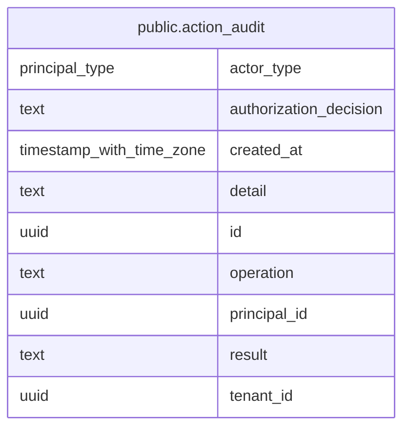

# public.action_audit

## Columns

| Name                   | Type                     | Default           | Nullable | Children | Parents | Comment |
| ---------------------- | ------------------------ | ----------------- | -------- | -------- | ------- | ------- |
| actor_type             | principal_type           |                   | false    |          |         |         |
| authorization_decision | text                     |                   | false    |          |         |         |
| created_at             | timestamp with time zone | now()             | false    |          |         |         |
| detail                 | text                     |                   | true     |          |         |         |
| id                     | uuid                     | gen_random_uuid() | false    |          |         |         |
| operation              | text                     |                   | false    |          |         |         |
| principal_id           | uuid                     |                   | false    |          |         |         |
| result                 | text                     |                   | false    |          |         |         |
| tenant_id              | uuid                     |                   | false    |          |         |         |

## Constraints

| Name              | Type        | Definition       |
| ----------------- | ----------- | ---------------- |
| action_audit_pkey | PRIMARY KEY | PRIMARY KEY (id) |

## Indexes

| Name                       | Definition                                                                                |
| -------------------------- | ----------------------------------------------------------------------------------------- |
| action_audit_created_idx   | CREATE INDEX action_audit_created_idx ON public.action_audit USING btree (created_at)     |
| action_audit_pkey          | CREATE UNIQUE INDEX action_audit_pkey ON public.action_audit USING btree (id)             |
| action_audit_principal_idx | CREATE INDEX action_audit_principal_idx ON public.action_audit USING btree (principal_id) |
| action_audit_tenant_idx    | CREATE INDEX action_audit_tenant_idx ON public.action_audit USING btree (tenant_id)       |

## Relations

---

> Generated by [tbls](https://github.com/k1LoW/tbls)
