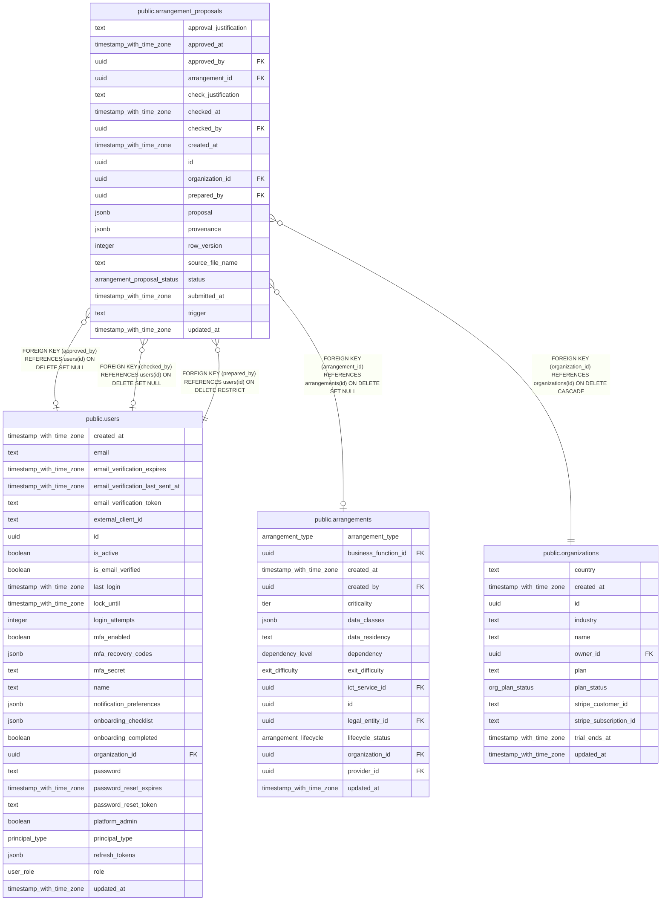

# public.arrangement_proposals

## Columns

| Name                   | Type                        | Default                                  | Nullable | Children | Parents                                         | Comment |
| ---------------------- | --------------------------- | ---------------------------------------- | -------- | -------- | ----------------------------------------------- | ------- |
| approval_justification | text                        | ''::text                                 | false    |          |                                                 |         |
| approved_at            | timestamp with time zone    |                                          | true     |          |                                                 |         |
| approved_by            | uuid                        |                                          | true     |          | [public.users](public.users.md)                 |         |
| arrangement_id         | uuid                        |                                          | true     |          | [public.arrangements](public.arrangements.md)   |         |
| check_justification    | text                        | ''::text                                 | false    |          |                                                 |         |
| checked_at             | timestamp with time zone    |                                          | true     |          |                                                 |         |
| checked_by             | uuid                        |                                          | true     |          | [public.users](public.users.md)                 |         |
| created_at             | timestamp with time zone    | now()                                    | false    |          |                                                 |         |
| id                     | uuid                        | gen_random_uuid()                        | false    |          |                                                 |         |
| organization_id        | uuid                        |                                          | false    |          | [public.organizations](public.organizations.md) |         |
| prepared_by            | uuid                        |                                          | false    |          | [public.users](public.users.md)                 |         |
| proposal               | jsonb                       | '{}'::jsonb                              | false    |          |                                                 |         |
| provenance             | jsonb                       | '{}'::jsonb                              | false    |          |                                                 |         |
| row_version            | integer                     | 1                                        | false    |          |                                                 |         |
| source_file_name       | text                        | 'Ingested contract'::text                | false    |          |                                                 |         |
| status                 | arrangement_proposal_status | 'submitted'::arrangement_proposal_status | false    |          |                                                 |         |
| submitted_at           | timestamp with time zone    | now()                                    | false    |          |                                                 |         |
| trigger                | text                        |                                          | true     |          |                                                 |         |
| updated_at             | timestamp with time zone    | now()                                    | false    |          |                                                 |         |

## Constraints

| Name                                                      | Type        | Definition                                                                   |
| --------------------------------------------------------- | ----------- | ---------------------------------------------------------------------------- |
| arrangement_proposals_approved_by_users_id_fk             | FOREIGN KEY | FOREIGN KEY (approved_by) REFERENCES users(id) ON DELETE SET NULL            |
| arrangement_proposals_arrangement_id_arrangements_id_fk   | FOREIGN KEY | FOREIGN KEY (arrangement_id) REFERENCES arrangements(id) ON DELETE SET NULL  |
| arrangement_proposals_checked_by_users_id_fk              | FOREIGN KEY | FOREIGN KEY (checked_by) REFERENCES users(id) ON DELETE SET NULL             |
| arrangement_proposals_organization_id_organizations_id_fk | FOREIGN KEY | FOREIGN KEY (organization_id) REFERENCES organizations(id) ON DELETE CASCADE |
| arrangement_proposals_pkey                                | PRIMARY KEY | PRIMARY KEY (id)                                                             |
| arrangement_proposals_prepared_by_users_id_fk             | FOREIGN KEY | FOREIGN KEY (prepared_by) REFERENCES users(id) ON DELETE RESTRICT            |

## Indexes

| Name                                  | Definition                                                                                                              |
| ------------------------------------- | ----------------------------------------------------------------------------------------------------------------------- |
| arrangement_proposals_org_status_idx  | CREATE INDEX arrangement_proposals_org_status_idx ON public.arrangement_proposals USING btree (organization_id, status) |
| arrangement_proposals_pkey            | CREATE UNIQUE INDEX arrangement_proposals_pkey ON public.arrangement_proposals USING btree (id)                         |
| arrangement_proposals_prepared_by_idx | CREATE INDEX arrangement_proposals_prepared_by_idx ON public.arrangement_proposals USING btree (prepared_by)            |

## Relations

---

> Generated by [tbls](https://github.com/k1LoW/tbls)
