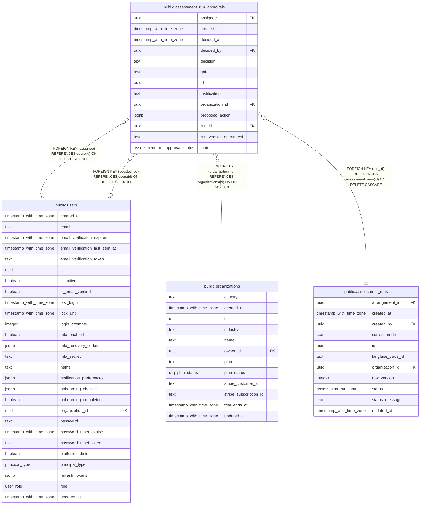

# public.assessment_run_approvals

## Columns

| Name                   | Type                           | Default                                   | Nullable | Children | Parents                                             | Comment |
| ---------------------- | ------------------------------ | ----------------------------------------- | -------- | -------- | --------------------------------------------------- | ------- |
| assignee               | uuid                           |                                           | true     |          | [public.users](public.users.md)                     |         |
| created_at             | timestamp with time zone       | now()                                     | false    |          |                                                     |         |
| decided_at             | timestamp with time zone       |                                           | true     |          |                                                     |         |
| decided_by             | uuid                           |                                           | true     |          | [public.users](public.users.md)                     |         |
| decision               | text                           |                                           | true     |          |                                                     |         |
| gate                   | text                           |                                           | false    |          |                                                     |         |
| id                     | uuid                           | gen_random_uuid()                         | false    |          |                                                     |         |
| justification          | text                           | ''::text                                  | false    |          |                                                     |         |
| organization_id        | uuid                           |                                           | false    |          | [public.organizations](public.organizations.md)     |         |
| proposed_action        | jsonb                          | '{}'::jsonb                               | false    |          |                                                     |         |
| run_id                 | uuid                           |                                           | false    |          | [public.assessment_runs](public.assessment_runs.md) |         |
| run_version_at_request | text                           | '0'::text                                 | false    |          |                                                     |         |
| status                 | assessment_run_approval_status | 'pending'::assessment_run_approval_status | false    |          |                                                     |         |

## Constraints

| Name                                                         | Type        | Definition                                                                   |
| ------------------------------------------------------------ | ----------- | ---------------------------------------------------------------------------- |
| assessment_run_approvals_assignee_users_id_fk                | FOREIGN KEY | FOREIGN KEY (assignee) REFERENCES users(id) ON DELETE SET NULL               |
| assessment_run_approvals_decided_by_users_id_fk              | FOREIGN KEY | FOREIGN KEY (decided_by) REFERENCES users(id) ON DELETE SET NULL             |
| assessment_run_approvals_organization_id_organizations_id_fk | FOREIGN KEY | FOREIGN KEY (organization_id) REFERENCES organizations(id) ON DELETE CASCADE |
| assessment_run_approvals_pkey                                | PRIMARY KEY | PRIMARY KEY (id)                                                             |
| assessment_run_approvals_run_id_assessment_runs_id_fk        | FOREIGN KEY | FOREIGN KEY (run_id) REFERENCES assessment_runs(id) ON DELETE CASCADE        |

## Indexes

| Name                               | Definition                                                                                                          |
| ---------------------------------- | ------------------------------------------------------------------------------------------------------------------- |
| arun_approvals_assignee_status_idx | CREATE INDEX arun_approvals_assignee_status_idx ON public.assessment_run_approvals USING btree (assignee, status)   |
| arun_approvals_org_status_idx      | CREATE INDEX arun_approvals_org_status_idx ON public.assessment_run_approvals USING btree (organization_id, status) |
| arun_approvals_run_idx             | CREATE INDEX arun_approvals_run_idx ON public.assessment_run_approvals USING btree (run_id)                         |
| assessment_run_approvals_pkey      | CREATE UNIQUE INDEX assessment_run_approvals_pkey ON public.assessment_run_approvals USING btree (id)               |

## Relations

---

> Generated by [tbls](https://github.com/k1LoW/tbls)
