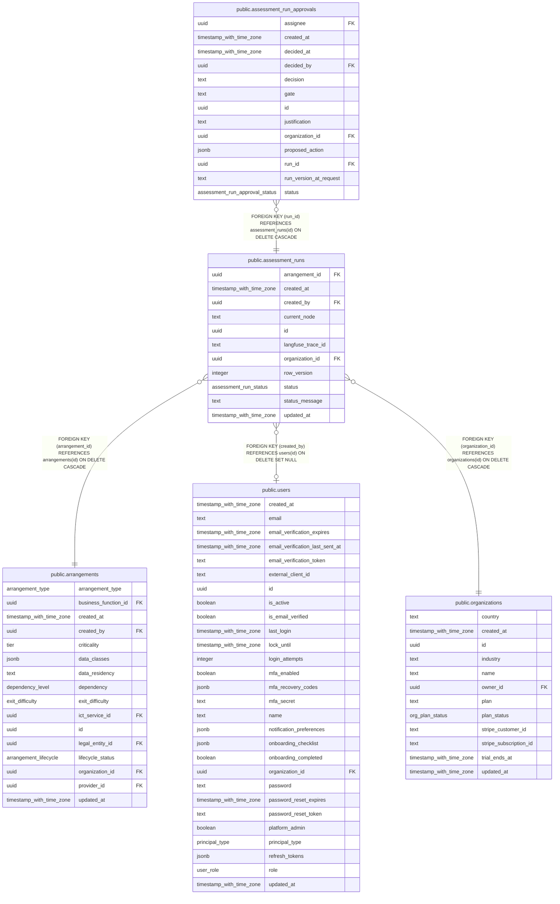

# public.assessment_runs

## Columns

| Name              | Type                     | Default                          | Nullable | Children                                                              | Parents                                         | Comment |
| ----------------- | ------------------------ | -------------------------------- | -------- | --------------------------------------------------------------------- | ----------------------------------------------- | ------- |
| arrangement_id    | uuid                     |                                  | false    |                                                                       | [public.arrangements](public.arrangements.md)   |         |
| created_at        | timestamp with time zone | now()                            | false    |                                                                       |                                                 |         |
| created_by        | uuid                     |                                  | true     |                                                                       | [public.users](public.users.md)                 |         |
| current_node      | text                     | 'intake'::text                   | false    |                                                                       |                                                 |         |
| id                | uuid                     | gen_random_uuid()                | false    | [public.assessment_run_approvals](public.assessment_run_approvals.md) |                                                 |         |
| langfuse_trace_id | text                     |                                  | true     |                                                                       |                                                 |         |
| organization_id   | uuid                     |                                  | false    |                                                                       | [public.organizations](public.organizations.md) |         |
| row_version       | integer                  | 0                                | false    |                                                                       |                                                 |         |
| status            | assessment_run_status    | 'running'::assessment_run_status | false    |                                                                       |                                                 |         |
| status_message    | text                     | ''::text                         | false    |                                                                       |                                                 |         |
| updated_at        | timestamp with time zone | now()                            | false    |                                                                       |                                                 |         |

## Constraints

| Name                                                | Type        | Definition                                                                   |
| --------------------------------------------------- | ----------- | ---------------------------------------------------------------------------- |
| assessment_runs_arrangement_id_arrangements_id_fk   | FOREIGN KEY | FOREIGN KEY (arrangement_id) REFERENCES arrangements(id) ON DELETE CASCADE   |
| assessment_runs_created_by_users_id_fk              | FOREIGN KEY | FOREIGN KEY (created_by) REFERENCES users(id) ON DELETE SET NULL             |
| assessment_runs_organization_id_organizations_id_fk | FOREIGN KEY | FOREIGN KEY (organization_id) REFERENCES organizations(id) ON DELETE CASCADE |
| assessment_runs_pkey                                | PRIMARY KEY | PRIMARY KEY (id)                                                             |

## Indexes

| Name                            | Definition                                                                                                                       |
| ------------------------------- | -------------------------------------------------------------------------------------------------------------------------------- |
| assessment_runs_arrangement_idx | CREATE INDEX assessment_runs_arrangement_idx ON public.assessment_runs USING btree (arrangement_id)                              |
| assessment_runs_org_created_idx | CREATE INDEX assessment_runs_org_created_idx ON public.assessment_runs USING btree (organization_id, created_at DESC NULLS LAST) |
| assessment_runs_pkey            | CREATE UNIQUE INDEX assessment_runs_pkey ON public.assessment_runs USING btree (id)                                              |
| assessment_runs_status_idx      | CREATE INDEX assessment_runs_status_idx ON public.assessment_runs USING btree (status)                                           |

## Relations

---

> Generated by [tbls](https://github.com/k1LoW/tbls)
