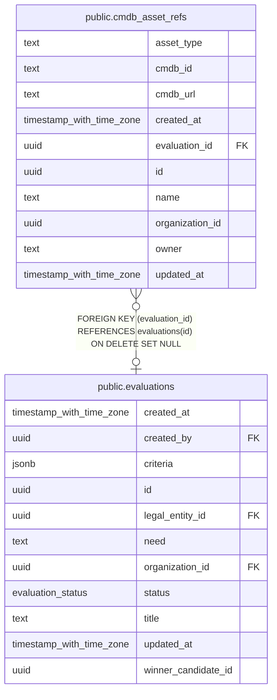

# public.cmdb_asset_refs

## Columns

| Name            | Type                     | Default           | Nullable | Children | Parents                                     | Comment |
| --------------- | ------------------------ | ----------------- | -------- | -------- | ------------------------------------------- | ------- |
| asset_type      | text                     |                   | true     |          |                                             |         |
| cmdb_id         | text                     |                   | false    |          |                                             |         |
| cmdb_url        | text                     |                   | true     |          |                                             |         |
| created_at      | timestamp with time zone | now()             | false    |          |                                             |         |
| evaluation_id   | uuid                     |                   | true     |          | [public.evaluations](public.evaluations.md) |         |
| id              | uuid                     | gen_random_uuid() | false    |          |                                             |         |
| name            | text                     |                   | false    |          |                                             |         |
| organization_id | uuid                     |                   | false    |          |                                             |         |
| owner           | text                     |                   | true     |          |                                             |         |
| updated_at      | timestamp with time zone | now()             | false    |          |                                             |         |

## Constraints

| Name                                            | Type        | Definition                                                                |
| ----------------------------------------------- | ----------- | ------------------------------------------------------------------------- |
| cmdb_asset_refs_evaluation_id_evaluations_id_fk | FOREIGN KEY | FOREIGN KEY (evaluation_id) REFERENCES evaluations(id) ON DELETE SET NULL |
| cmdb_asset_refs_pkey                            | PRIMARY KEY | PRIMARY KEY (id)                                                          |

## Indexes

| Name                           | Definition                                                                                        |
| ------------------------------ | ------------------------------------------------------------------------------------------------- |
| cmdb_asset_refs_evaluation_idx | CREATE INDEX cmdb_asset_refs_evaluation_idx ON public.cmdb_asset_refs USING btree (evaluation_id) |
| cmdb_asset_refs_org_idx        | CREATE INDEX cmdb_asset_refs_org_idx ON public.cmdb_asset_refs USING btree (organization_id)      |
| cmdb_asset_refs_pkey           | CREATE UNIQUE INDEX cmdb_asset_refs_pkey ON public.cmdb_asset_refs USING btree (id)               |

## Relations

---

> Generated by [tbls](https://github.com/k1LoW/tbls)
