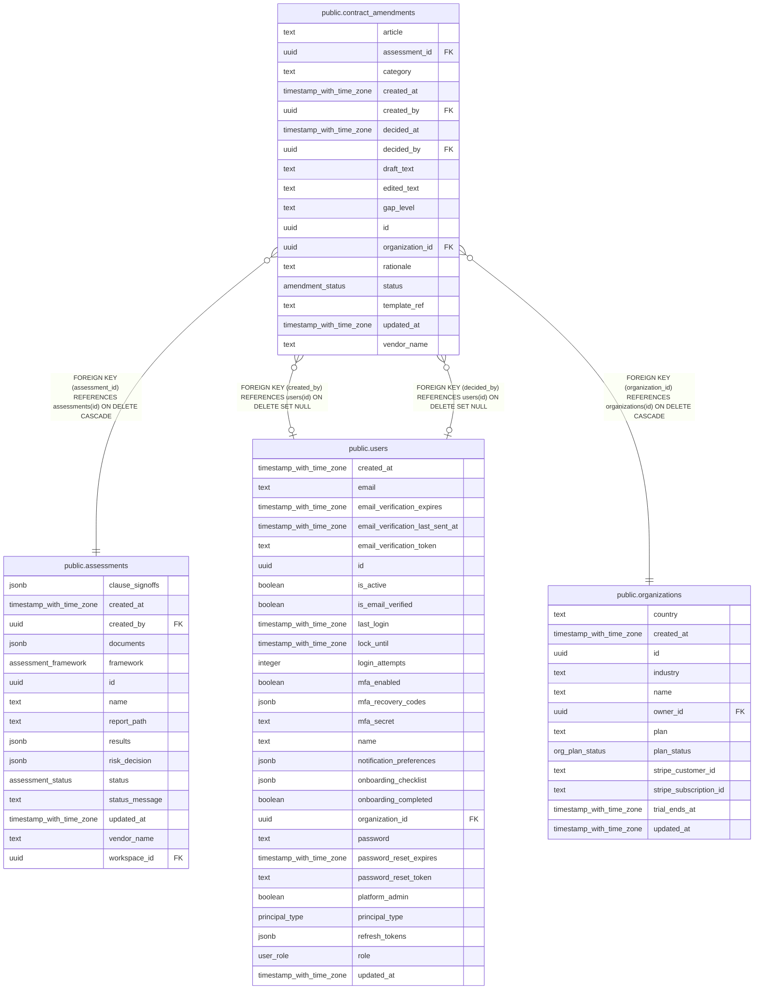

# public.contract_amendments

## Columns

| Name            | Type                     | Default                     | Nullable | Children | Parents                                         | Comment |
| --------------- | ------------------------ | --------------------------- | -------- | -------- | ----------------------------------------------- | ------- |
| article         | text                     |                             | false    |          |                                                 |         |
| assessment_id   | uuid                     |                             | false    |          | [public.assessments](public.assessments.md)     |         |
| category        | text                     | ''::text                    | false    |          |                                                 |         |
| created_at      | timestamp with time zone | now()                       | false    |          |                                                 |         |
| created_by      | uuid                     |                             | true     |          | [public.users](public.users.md)                 |         |
| decided_at      | timestamp with time zone |                             | true     |          |                                                 |         |
| decided_by      | uuid                     |                             | true     |          | [public.users](public.users.md)                 |         |
| draft_text      | text                     | ''::text                    | false    |          |                                                 |         |
| edited_text     | text                     | ''::text                    | false    |          |                                                 |         |
| gap_level       | text                     | 'missing'::text             | false    |          |                                                 |         |
| id              | uuid                     | gen_random_uuid()           | false    |          |                                                 |         |
| organization_id | uuid                     |                             | false    |          | [public.organizations](public.organizations.md) |         |
| rationale       | text                     | ''::text                    | false    |          |                                                 |         |
| status          | amendment_status         | 'pending'::amendment_status | false    |          |                                                 |         |
| template_ref    | text                     | ''::text                    | false    |          |                                                 |         |
| updated_at      | timestamp with time zone | now()                       | false    |          |                                                 |         |
| vendor_name     | text                     | ''::text                    | false    |          |                                                 |         |

## Constraints

| Name                                                    | Type        | Definition                                                                   |
| ------------------------------------------------------- | ----------- | ---------------------------------------------------------------------------- |
| contract_amendments_assessment_id_assessments_id_fk     | FOREIGN KEY | FOREIGN KEY (assessment_id) REFERENCES assessments(id) ON DELETE CASCADE     |
| contract_amendments_created_by_users_id_fk              | FOREIGN KEY | FOREIGN KEY (created_by) REFERENCES users(id) ON DELETE SET NULL             |
| contract_amendments_decided_by_users_id_fk              | FOREIGN KEY | FOREIGN KEY (decided_by) REFERENCES users(id) ON DELETE SET NULL             |
| contract_amendments_organization_id_organizations_id_fk | FOREIGN KEY | FOREIGN KEY (organization_id) REFERENCES organizations(id) ON DELETE CASCADE |
| contract_amendments_pkey                                | PRIMARY KEY | PRIMARY KEY (id)                                                             |

## Indexes

| Name                               | Definition                                                                                                                            |
| ---------------------------------- | ------------------------------------------------------------------------------------------------------------------------------------- |
| contract_amendments_assessment_idx | CREATE INDEX contract_amendments_assessment_idx ON public.contract_amendments USING btree (assessment_id)                             |
| contract_amendments_dedup_idx      | CREATE UNIQUE INDEX contract_amendments_dedup_idx ON public.contract_amendments USING btree (organization_id, assessment_id, article) |
| contract_amendments_org_status_idx | CREATE INDEX contract_amendments_org_status_idx ON public.contract_amendments USING btree (organization_id, status)                   |
| contract_amendments_pkey           | CREATE UNIQUE INDEX contract_amendments_pkey ON public.contract_amendments USING btree (id)                                           |

## Relations

---

> Generated by [tbls](https://github.com/k1LoW/tbls)
