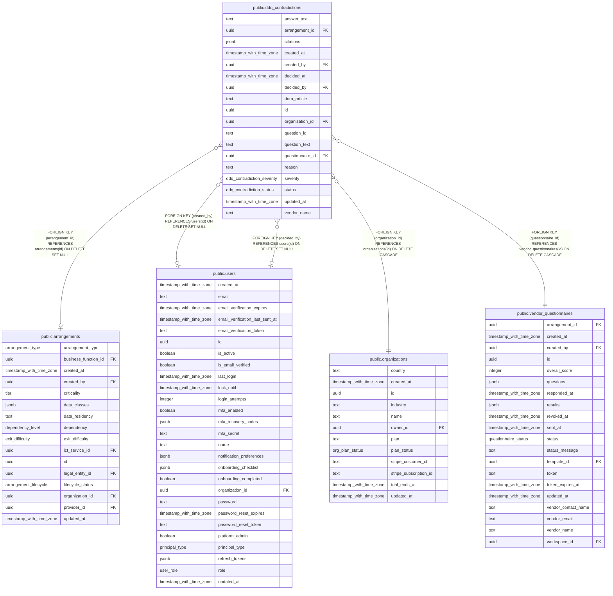

# public.ddq_contradictions

## Columns

| Name             | Type                       | Default                              | Nullable | Children | Parents                                                         | Comment |
| ---------------- | -------------------------- | ------------------------------------ | -------- | -------- | --------------------------------------------------------------- | ------- |
| answer_text      | text                       | ''::text                             | false    |          |                                                                 |         |
| arrangement_id   | uuid                       |                                      | true     |          | [public.arrangements](public.arrangements.md)                   |         |
| citations        | jsonb                      | '[]'::jsonb                          | false    |          |                                                                 |         |
| created_at       | timestamp with time zone   | now()                                | false    |          |                                                                 |         |
| created_by       | uuid                       |                                      | true     |          | [public.users](public.users.md)                                 |         |
| decided_at       | timestamp with time zone   |                                      | true     |          |                                                                 |         |
| decided_by       | uuid                       |                                      | true     |          | [public.users](public.users.md)                                 |         |
| dora_article     | text                       | ''::text                             | false    |          |                                                                 |         |
| id               | uuid                       | gen_random_uuid()                    | false    |          |                                                                 |         |
| organization_id  | uuid                       |                                      | false    |          | [public.organizations](public.organizations.md)                 |         |
| question_id      | text                       |                                      | false    |          |                                                                 |         |
| question_text    | text                       | ''::text                             | false    |          |                                                                 |         |
| questionnaire_id | uuid                       |                                      | false    |          | [public.vendor_questionnaires](public.vendor_questionnaires.md) |         |
| reason           | text                       | ''::text                             | false    |          |                                                                 |         |
| severity         | ddq_contradiction_severity | 'medium'::ddq_contradiction_severity | false    |          |                                                                 |         |
| status           | ddq_contradiction_status   | 'open'::ddq_contradiction_status     | false    |          |                                                                 |         |
| updated_at       | timestamp with time zone   | now()                                | false    |          |                                                                 |         |
| vendor_name      | text                       | ''::text                             | false    |          |                                                                 |         |

## Constraints

| Name                                                            | Type        | Definition                                                                            |
| --------------------------------------------------------------- | ----------- | ------------------------------------------------------------------------------------- |
| ddq_contradictions_arrangement_id_arrangements_id_fk            | FOREIGN KEY | FOREIGN KEY (arrangement_id) REFERENCES arrangements(id) ON DELETE SET NULL           |
| ddq_contradictions_created_by_users_id_fk                       | FOREIGN KEY | FOREIGN KEY (created_by) REFERENCES users(id) ON DELETE SET NULL                      |
| ddq_contradictions_decided_by_users_id_fk                       | FOREIGN KEY | FOREIGN KEY (decided_by) REFERENCES users(id) ON DELETE SET NULL                      |
| ddq_contradictions_organization_id_organizations_id_fk          | FOREIGN KEY | FOREIGN KEY (organization_id) REFERENCES organizations(id) ON DELETE CASCADE          |
| ddq_contradictions_pkey                                         | PRIMARY KEY | PRIMARY KEY (id)                                                                      |
| ddq_contradictions_questionnaire_id_vendor_questionnaires_id_fk | FOREIGN KEY | FOREIGN KEY (questionnaire_id) REFERENCES vendor_questionnaires(id) ON DELETE CASCADE |

## Indexes

| Name                                 | Definition                                                                                                                                 |
| ------------------------------------ | ------------------------------------------------------------------------------------------------------------------------------------------ |
| ddq_contradictions_dedup_idx         | CREATE UNIQUE INDEX ddq_contradictions_dedup_idx ON public.ddq_contradictions USING btree (organization_id, questionnaire_id, question_id) |
| ddq_contradictions_org_status_idx    | CREATE INDEX ddq_contradictions_org_status_idx ON public.ddq_contradictions USING btree (organization_id, status)                          |
| ddq_contradictions_pkey              | CREATE UNIQUE INDEX ddq_contradictions_pkey ON public.ddq_contradictions USING btree (id)                                                  |
| ddq_contradictions_questionnaire_idx | CREATE INDEX ddq_contradictions_questionnaire_idx ON public.ddq_contradictions USING btree (questionnaire_id)                              |

## Relations

---

> Generated by [tbls](https://github.com/k1LoW/tbls)
