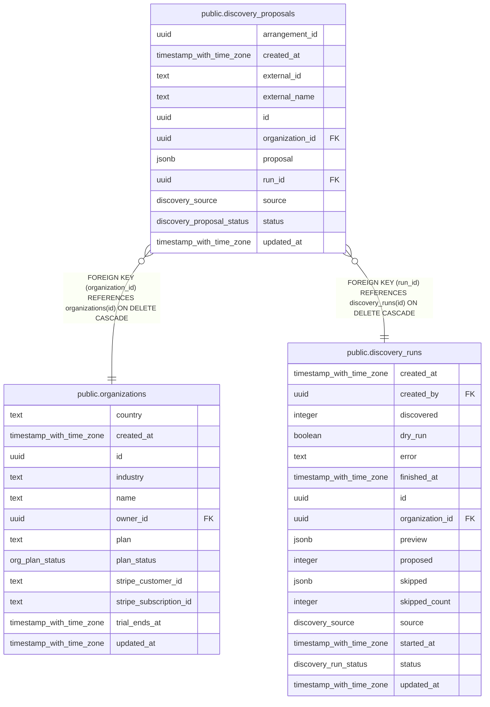

# public.discovery_proposals

## Columns

| Name            | Type                      | Default                              | Nullable | Children | Parents                                           | Comment |
| --------------- | ------------------------- | ------------------------------------ | -------- | -------- | ------------------------------------------------- | ------- |
| arrangement_id  | uuid                      |                                      | true     |          |                                                   |         |
| created_at      | timestamp with time zone  | now()                                | false    |          |                                                   |         |
| external_id     | text                      |                                      | false    |          |                                                   |         |
| external_name   | text                      | ''::text                             | false    |          |                                                   |         |
| id              | uuid                      | gen_random_uuid()                    | false    |          |                                                   |         |
| organization_id | uuid                      |                                      | false    |          | [public.organizations](public.organizations.md)   |         |
| proposal        | jsonb                     | '{}'::jsonb                          | false    |          |                                                   |         |
| run_id          | uuid                      |                                      | false    |          | [public.discovery_runs](public.discovery_runs.md) |         |
| source          | discovery_source          |                                      | false    |          |                                                   |         |
| status          | discovery_proposal_status | 'pending'::discovery_proposal_status | false    |          |                                                   |         |
| updated_at      | timestamp with time zone  | now()                                | false    |          |                                                   |         |

## Constraints

| Name                                                    | Type        | Definition                                                                   |
| ------------------------------------------------------- | ----------- | ---------------------------------------------------------------------------- |
| discovery_proposals_organization_id_organizations_id_fk | FOREIGN KEY | FOREIGN KEY (organization_id) REFERENCES organizations(id) ON DELETE CASCADE |
| discovery_proposals_pkey                                | PRIMARY KEY | PRIMARY KEY (id)                                                             |
| discovery_proposals_run_id_discovery_runs_id_fk         | FOREIGN KEY | FOREIGN KEY (run_id) REFERENCES discovery_runs(id) ON DELETE CASCADE         |

## Indexes

| Name                               | Definition                                                                                                          |
| ---------------------------------- | ------------------------------------------------------------------------------------------------------------------- |
| discovery_proposals_org_status_idx | CREATE INDEX discovery_proposals_org_status_idx ON public.discovery_proposals USING btree (organization_id, status) |
| discovery_proposals_pkey           | CREATE UNIQUE INDEX discovery_proposals_pkey ON public.discovery_proposals USING btree (id)                         |
| discovery_proposals_run_idx        | CREATE INDEX discovery_proposals_run_idx ON public.discovery_proposals USING btree (run_id)                         |

## Relations

---

> Generated by [tbls](https://github.com/k1LoW/tbls)
