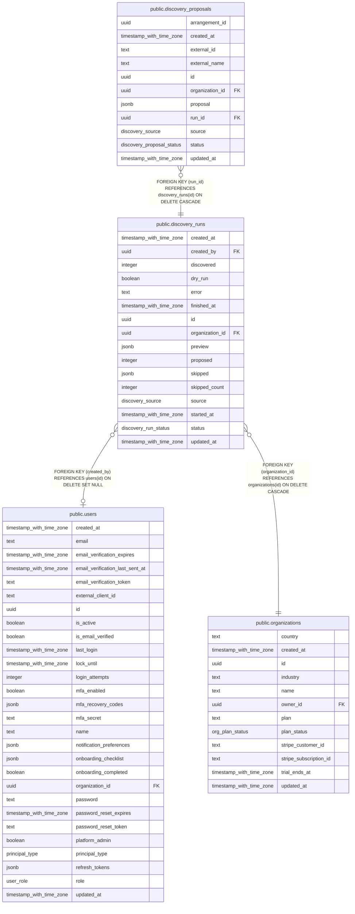

# public.discovery_runs

## Columns

| Name            | Type                     | Default                        | Nullable | Children                                                    | Parents                                         | Comment |
| --------------- | ------------------------ | ------------------------------ | -------- | ----------------------------------------------------------- | ----------------------------------------------- | ------- |
| created_at      | timestamp with time zone | now()                          | false    |                                                             |                                                 |         |
| created_by      | uuid                     |                                | true     |                                                             | [public.users](public.users.md)                 |         |
| discovered      | integer                  | 0                              | false    |                                                             |                                                 |         |
| dry_run         | boolean                  | false                          | false    |                                                             |                                                 |         |
| error           | text                     | ''::text                       | false    |                                                             |                                                 |         |
| finished_at     | timestamp with time zone |                                | true     |                                                             |                                                 |         |
| id              | uuid                     | gen_random_uuid()              | false    | [public.discovery_proposals](public.discovery_proposals.md) |                                                 |         |
| organization_id | uuid                     |                                | false    |                                                             | [public.organizations](public.organizations.md) |         |
| preview         | jsonb                    |                                | true     |                                                             |                                                 |         |
| proposed        | integer                  | 0                              | false    |                                                             |                                                 |         |
| skipped         | jsonb                    | '[]'::jsonb                    | false    |                                                             |                                                 |         |
| skipped_count   | integer                  | 0                              | false    |                                                             |                                                 |         |
| source          | discovery_source         |                                | false    |                                                             |                                                 |         |
| started_at      | timestamp with time zone |                                | true     |                                                             |                                                 |         |
| status          | discovery_run_status     | 'queued'::discovery_run_status | false    |                                                             |                                                 |         |
| updated_at      | timestamp with time zone | now()                          | false    |                                                             |                                                 |         |

## Constraints

| Name                                               | Type        | Definition                                                                   |
| -------------------------------------------------- | ----------- | ---------------------------------------------------------------------------- |
| discovery_runs_created_by_users_id_fk              | FOREIGN KEY | FOREIGN KEY (created_by) REFERENCES users(id) ON DELETE SET NULL             |
| discovery_runs_organization_id_organizations_id_fk | FOREIGN KEY | FOREIGN KEY (organization_id) REFERENCES organizations(id) ON DELETE CASCADE |
| discovery_runs_pkey                                | PRIMARY KEY | PRIMARY KEY (id)                                                             |

## Indexes

| Name                           | Definition                                                                                                     |
| ------------------------------ | -------------------------------------------------------------------------------------------------------------- |
| discovery_runs_org_created_idx | CREATE INDEX discovery_runs_org_created_idx ON public.discovery_runs USING btree (organization_id, created_at) |
| discovery_runs_org_status_idx  | CREATE INDEX discovery_runs_org_status_idx ON public.discovery_runs USING btree (organization_id, status)      |
| discovery_runs_pkey            | CREATE UNIQUE INDEX discovery_runs_pkey ON public.discovery_runs USING btree (id)                              |

## Relations

---

> Generated by [tbls](https://github.com/k1LoW/tbls)
