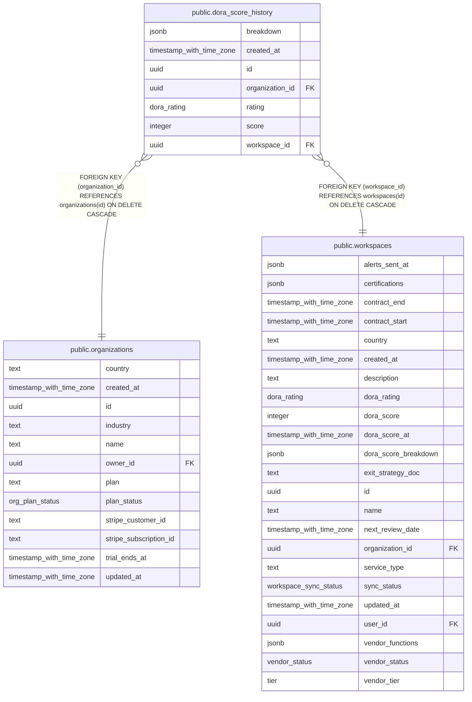

# public.dora_score_history

## Columns

| Name            | Type                     | Default           | Nullable | Children | Parents                                         | Comment |
| --------------- | ------------------------ | ----------------- | -------- | -------- | ----------------------------------------------- | ------- |
| breakdown       | jsonb                    | '{}'::jsonb       | false    |          |                                                 |         |
| created_at      | timestamp with time zone | now()             | false    |          |                                                 |         |
| id              | uuid                     | gen_random_uuid() | false    |          |                                                 |         |
| organization_id | uuid                     |                   | false    |          | [public.organizations](public.organizations.md) |         |
| rating          | dora_rating              |                   | false    |          |                                                 |         |
| score           | integer                  |                   | false    |          |                                                 |         |
| workspace_id    | uuid                     |                   | false    |          | [public.workspaces](public.workspaces.md)       |         |

## Constraints

| Name                                                   | Type        | Definition                                                                   |
| ------------------------------------------------------ | ----------- | ---------------------------------------------------------------------------- |
| dora_score_history_organization_id_organizations_id_fk | FOREIGN KEY | FOREIGN KEY (organization_id) REFERENCES organizations(id) ON DELETE CASCADE |
| dora_score_history_pkey                                | PRIMARY KEY | PRIMARY KEY (id)                                                             |
| dora_score_history_workspace_id_workspaces_id_fk       | FOREIGN KEY | FOREIGN KEY (workspace_id) REFERENCES workspaces(id) ON DELETE CASCADE       |

## Indexes

| Name                              | Definition                                                                                                                         |
| --------------------------------- | ---------------------------------------------------------------------------------------------------------------------------------- |
| dora_score_history_pkey           | CREATE UNIQUE INDEX dora_score_history_pkey ON public.dora_score_history USING btree (id)                                          |
| dora_score_history_ws_created_idx | CREATE INDEX dora_score_history_ws_created_idx ON public.dora_score_history USING btree (workspace_id, created_at DESC NULLS LAST) |

## Relations

---

> Generated by [tbls](https://github.com/k1LoW/tbls)
