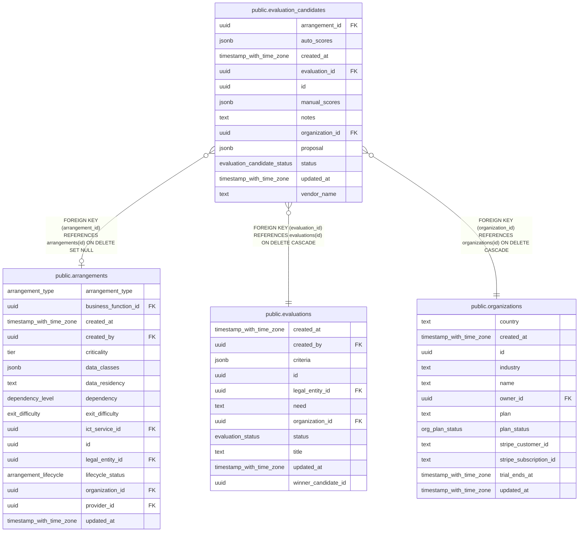

# public.evaluation_candidates

## Columns

| Name            | Type                        | Default                                  | Nullable | Children | Parents                                         | Comment |
| --------------- | --------------------------- | ---------------------------------------- | -------- | -------- | ----------------------------------------------- | ------- |
| arrangement_id  | uuid                        |                                          | true     |          | [public.arrangements](public.arrangements.md)   |         |
| auto_scores     | jsonb                       | '{}'::jsonb                              | false    |          |                                                 |         |
| created_at      | timestamp with time zone    | now()                                    | false    |          |                                                 |         |
| evaluation_id   | uuid                        |                                          | false    |          | [public.evaluations](public.evaluations.md)     |         |
| id              | uuid                        | gen_random_uuid()                        | false    |          |                                                 |         |
| manual_scores   | jsonb                       | '{}'::jsonb                              | false    |          |                                                 |         |
| notes           | text                        | ''::text                                 | false    |          |                                                 |         |
| organization_id | uuid                        |                                          | false    |          | [public.organizations](public.organizations.md) |         |
| proposal        | jsonb                       | '{}'::jsonb                              | false    |          |                                                 |         |
| status          | evaluation_candidate_status | 'candidate'::evaluation_candidate_status | false    |          |                                                 |         |
| updated_at      | timestamp with time zone    | now()                                    | false    |          |                                                 |         |
| vendor_name     | text                        |                                          | false    |          |                                                 |         |

## Constraints

| Name                                                      | Type        | Definition                                                                   |
| --------------------------------------------------------- | ----------- | ---------------------------------------------------------------------------- |
| evaluation_candidates_arrangement_id_arrangements_id_fk   | FOREIGN KEY | FOREIGN KEY (arrangement_id) REFERENCES arrangements(id) ON DELETE SET NULL  |
| evaluation_candidates_evaluation_id_evaluations_id_fk     | FOREIGN KEY | FOREIGN KEY (evaluation_id) REFERENCES evaluations(id) ON DELETE CASCADE     |
| evaluation_candidates_organization_id_organizations_id_fk | FOREIGN KEY | FOREIGN KEY (organization_id) REFERENCES organizations(id) ON DELETE CASCADE |
| evaluation_candidates_pkey                                | PRIMARY KEY | PRIMARY KEY (id)                                                             |

## Indexes

| Name                           | Definition                                                                                               |
| ------------------------------ | -------------------------------------------------------------------------------------------------------- |
| evaluation_candidates_eval_idx | CREATE INDEX evaluation_candidates_eval_idx ON public.evaluation_candidates USING btree (evaluation_id)  |
| evaluation_candidates_org_idx  | CREATE INDEX evaluation_candidates_org_idx ON public.evaluation_candidates USING btree (organization_id) |
| evaluation_candidates_pkey     | CREATE UNIQUE INDEX evaluation_candidates_pkey ON public.evaluation_candidates USING btree (id)          |

## Relations

---

> Generated by [tbls](https://github.com/k1LoW/tbls)
