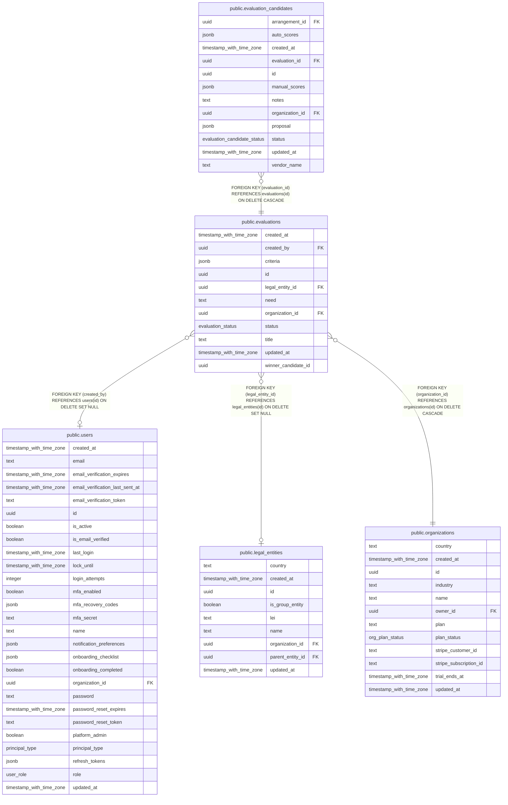

# public.evaluations

## Columns

| Name                | Type                     | Default                    | Nullable | Children                                                        | Parents                                           | Comment |
| ------------------- | ------------------------ | -------------------------- | -------- | --------------------------------------------------------------- | ------------------------------------------------- | ------- |
| created_at          | timestamp with time zone | now()                      | false    |                                                                 |                                                   |         |
| created_by          | uuid                     |                            | true     |                                                                 | [public.users](public.users.md)                   |         |
| criteria            | jsonb                    | '[]'::jsonb                | false    |                                                                 |                                                   |         |
| id                  | uuid                     | gen_random_uuid()          | false    | [public.evaluation_candidates](public.evaluation_candidates.md) |                                                   |         |
| legal_entity_id     | uuid                     |                            | true     |                                                                 | [public.legal_entities](public.legal_entities.md) |         |
| need                | text                     | ''::text                   | false    |                                                                 |                                                   |         |
| organization_id     | uuid                     |                            | false    |                                                                 | [public.organizations](public.organizations.md)   |         |
| status              | evaluation_status        | 'draft'::evaluation_status | false    |                                                                 |                                                   |         |
| title               | text                     |                            | false    |                                                                 |                                                   |         |
| updated_at          | timestamp with time zone | now()                      | false    |                                                                 |                                                   |         |
| winner_candidate_id | uuid                     |                            | true     |                                                                 |                                                   |         |

## Constraints

| Name                                             | Type        | Definition                                                                     |
| ------------------------------------------------ | ----------- | ------------------------------------------------------------------------------ |
| evaluations_created_by_users_id_fk               | FOREIGN KEY | FOREIGN KEY (created_by) REFERENCES users(id) ON DELETE SET NULL               |
| evaluations_legal_entity_id_legal_entities_id_fk | FOREIGN KEY | FOREIGN KEY (legal_entity_id) REFERENCES legal_entities(id) ON DELETE SET NULL |
| evaluations_organization_id_organizations_id_fk  | FOREIGN KEY | FOREIGN KEY (organization_id) REFERENCES organizations(id) ON DELETE CASCADE   |
| evaluations_pkey                                 | PRIMARY KEY | PRIMARY KEY (id)                                                               |

## Indexes

| Name                       | Definition                                                                                          |
| -------------------------- | --------------------------------------------------------------------------------------------------- |
| evaluations_entity_idx     | CREATE INDEX evaluations_entity_idx ON public.evaluations USING btree (legal_entity_id)             |
| evaluations_org_status_idx | CREATE INDEX evaluations_org_status_idx ON public.evaluations USING btree (organization_id, status) |
| evaluations_pkey           | CREATE UNIQUE INDEX evaluations_pkey ON public.evaluations USING btree (id)                         |

## Relations

---

> Generated by [tbls](https://github.com/k1LoW/tbls)
