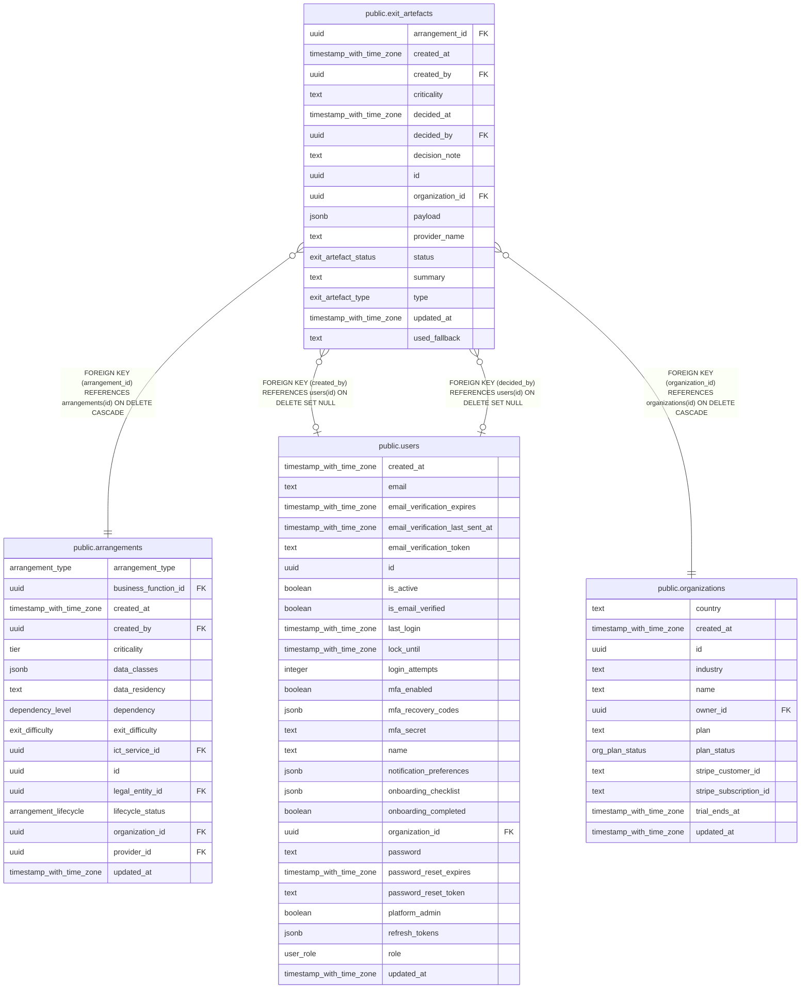

# public.exit_artefacts

## Columns

| Name            | Type                     | Default                       | Nullable | Children | Parents                                         | Comment |
| --------------- | ------------------------ | ----------------------------- | -------- | -------- | ----------------------------------------------- | ------- |
| arrangement_id  | uuid                     |                               | false    |          | [public.arrangements](public.arrangements.md)   |         |
| created_at      | timestamp with time zone | now()                         | false    |          |                                                 |         |
| created_by      | uuid                     |                               | true     |          | [public.users](public.users.md)                 |         |
| criticality     | text                     | ''::text                      | false    |          |                                                 |         |
| decided_at      | timestamp with time zone |                               | true     |          |                                                 |         |
| decided_by      | uuid                     |                               | true     |          | [public.users](public.users.md)                 |         |
| decision_note   | text                     | ''::text                      | false    |          |                                                 |         |
| id              | uuid                     | gen_random_uuid()             | false    |          |                                                 |         |
| organization_id | uuid                     |                               | false    |          | [public.organizations](public.organizations.md) |         |
| payload         | jsonb                    | '{}'::jsonb                   | false    |          |                                                 |         |
| provider_name   | text                     | ''::text                      | false    |          |                                                 |         |
| status          | exit_artefact_status     | 'draft'::exit_artefact_status | false    |          |                                                 |         |
| summary         | text                     | ''::text                      | false    |          |                                                 |         |
| type            | exit_artefact_type       |                               | false    |          |                                                 |         |
| updated_at      | timestamp with time zone | now()                         | false    |          |                                                 |         |
| used_fallback   | text                     | 'false'::text                 | false    |          |                                                 |         |

## Constraints

| Name                                               | Type        | Definition                                                                   |
| -------------------------------------------------- | ----------- | ---------------------------------------------------------------------------- |
| exit_artefacts_arrangement_id_arrangements_id_fk   | FOREIGN KEY | FOREIGN KEY (arrangement_id) REFERENCES arrangements(id) ON DELETE CASCADE   |
| exit_artefacts_created_by_users_id_fk              | FOREIGN KEY | FOREIGN KEY (created_by) REFERENCES users(id) ON DELETE SET NULL             |
| exit_artefacts_decided_by_users_id_fk              | FOREIGN KEY | FOREIGN KEY (decided_by) REFERENCES users(id) ON DELETE SET NULL             |
| exit_artefacts_organization_id_organizations_id_fk | FOREIGN KEY | FOREIGN KEY (organization_id) REFERENCES organizations(id) ON DELETE CASCADE |
| exit_artefacts_pkey                                | PRIMARY KEY | PRIMARY KEY (id)                                                             |

## Indexes

| Name                           | Definition                                                                                                                |
| ------------------------------ | ------------------------------------------------------------------------------------------------------------------------- |
| exit_artefacts_arrangement_idx | CREATE INDEX exit_artefacts_arrangement_idx ON public.exit_artefacts USING btree (arrangement_id)                         |
| exit_artefacts_dedup_idx       | CREATE UNIQUE INDEX exit_artefacts_dedup_idx ON public.exit_artefacts USING btree (organization_id, arrangement_id, type) |
| exit_artefacts_org_status_idx  | CREATE INDEX exit_artefacts_org_status_idx ON public.exit_artefacts USING btree (organization_id, status)                 |
| exit_artefacts_pkey            | CREATE UNIQUE INDEX exit_artefacts_pkey ON public.exit_artefacts USING btree (id)                                         |

## Relations

---

> Generated by [tbls](https://github.com/k1LoW/tbls)
