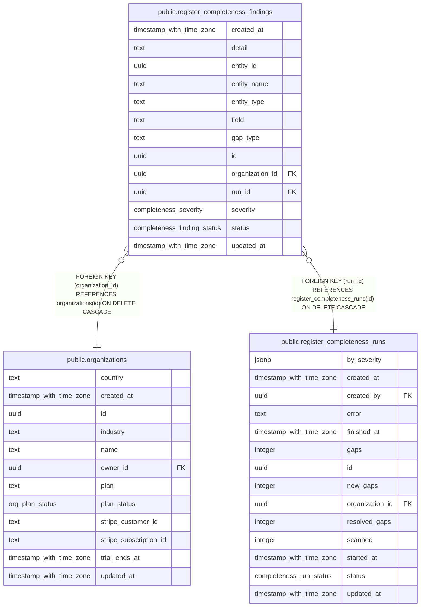

# public.register_completeness_findings

## Columns

| Name            | Type                        | Default                             | Nullable | Children | Parents                                                                   | Comment |
| --------------- | --------------------------- | ----------------------------------- | -------- | -------- | ------------------------------------------------------------------------- | ------- |
| created_at      | timestamp with time zone    | now()                               | false    |          |                                                                           |         |
| detail          | text                        | ''::text                            | false    |          |                                                                           |         |
| entity_id       | uuid                        |                                     | false    |          |                                                                           |         |
| entity_name     | text                        | ''::text                            | false    |          |                                                                           |         |
| entity_type     | text                        |                                     | false    |          |                                                                           |         |
| field           | text                        | ''::text                            | false    |          |                                                                           |         |
| gap_type        | text                        |                                     | false    |          |                                                                           |         |
| id              | uuid                        | gen_random_uuid()                   | false    |          |                                                                           |         |
| organization_id | uuid                        |                                     | false    |          | [public.organizations](public.organizations.md)                           |         |
| run_id          | uuid                        |                                     | false    |          | [public.register_completeness_runs](public.register_completeness_runs.md) |         |
| severity        | completeness_severity       | 'medium'::completeness_severity     | false    |          |                                                                           |         |
| status          | completeness_finding_status | 'open'::completeness_finding_status | false    |          |                                                                           |         |
| updated_at      | timestamp with time zone    | now()                               | false    |          |                                                                           |         |

## Constraints

| Name                                                            | Type        | Definition                                                                       |
| --------------------------------------------------------------- | ----------- | -------------------------------------------------------------------------------- |
| register_completeness_findings_organization_id_organizations_id | FOREIGN KEY | FOREIGN KEY (organization_id) REFERENCES organizations(id) ON DELETE CASCADE     |
| register_completeness_findings_pkey                             | PRIMARY KEY | PRIMARY KEY (id)                                                                 |
| register_completeness_findings_run_id_register_completeness_run | FOREIGN KEY | FOREIGN KEY (run_id) REFERENCES register_completeness_runs(id) ON DELETE CASCADE |

## Indexes

| Name                                 | Definition                                                                                                                                                 |
| ------------------------------------ | ---------------------------------------------------------------------------------------------------------------------------------------------------------- |
| completeness_findings_key_idx        | CREATE INDEX completeness_findings_key_idx ON public.register_completeness_findings USING btree (organization_id, entity_type, entity_id, gap_type, field) |
| completeness_findings_org_status_idx | CREATE INDEX completeness_findings_org_status_idx ON public.register_completeness_findings USING btree (organization_id, status)                           |
| completeness_findings_run_idx        | CREATE INDEX completeness_findings_run_idx ON public.register_completeness_findings USING btree (run_id)                                                   |
| register_completeness_findings_pkey  | CREATE UNIQUE INDEX register_completeness_findings_pkey ON public.register_completeness_findings USING btree (id)                                          |

## Relations

---

> Generated by [tbls](https://github.com/k1LoW/tbls)
