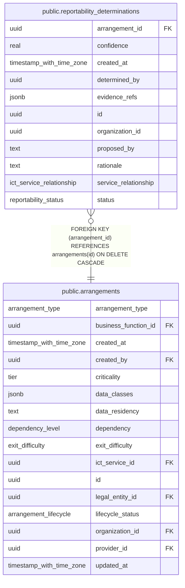

# public.reportability_determinations

## Columns

| Name                 | Type                     | Default           | Nullable | Children | Parents                                       | Comment |
| -------------------- | ------------------------ | ----------------- | -------- | -------- | --------------------------------------------- | ------- |
| arrangement_id       | uuid                     |                   | false    |          | [public.arrangements](public.arrangements.md) |         |
| confidence           | real                     |                   | true     |          |                                               |         |
| created_at           | timestamp with time zone | now()             | false    |          |                                               |         |
| determined_by        | uuid                     |                   | true     |          |                                               |         |
| evidence_refs        | jsonb                    | '[]'::jsonb       | false    |          |                                               |         |
| id                   | uuid                     | gen_random_uuid() | false    |          |                                               |         |
| organization_id      | uuid                     |                   | false    |          |                                               |         |
| proposed_by          | text                     |                   | true     |          |                                               |         |
| rationale            | text                     |                   | true     |          |                                               |         |
| service_relationship | ict_service_relationship |                   | true     |          |                                               |         |
| status               | reportability_status     |                   | false    |          |                                               |         |

## Constraints

| Name                                                           | Type        | Definition                                                                 |
| -------------------------------------------------------------- | ----------- | -------------------------------------------------------------------------- |
| reportability_determinations_arrangement_id_arrangements_id_fk | FOREIGN KEY | FOREIGN KEY (arrangement_id) REFERENCES arrangements(id) ON DELETE CASCADE |
| reportability_determinations_pkey                              | PRIMARY KEY | PRIMARY KEY (id)                                                           |

## Indexes

| Name                                         | Definition                                                                                                                    |
| -------------------------------------------- | ----------------------------------------------------------------------------------------------------------------------------- |
| reportability_determinations_arrangement_idx | CREATE INDEX reportability_determinations_arrangement_idx ON public.reportability_determinations USING btree (arrangement_id) |
| reportability_determinations_created_idx     | CREATE INDEX reportability_determinations_created_idx ON public.reportability_determinations USING btree (created_at)         |
| reportability_determinations_org_idx         | CREATE INDEX reportability_determinations_org_idx ON public.reportability_determinations USING btree (organization_id)        |
| reportability_determinations_pkey            | CREATE UNIQUE INDEX reportability_determinations_pkey ON public.reportability_determinations USING btree (id)                 |

## Relations

---

> Generated by [tbls](https://github.com/k1LoW/tbls)
