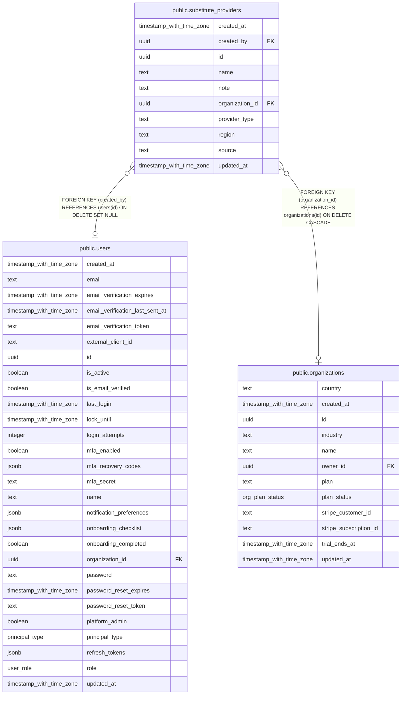

# public.substitute_providers

## Columns

| Name            | Type                     | Default           | Nullable | Children | Parents                                         | Comment |
| --------------- | ------------------------ | ----------------- | -------- | -------- | ----------------------------------------------- | ------- |
| created_at      | timestamp with time zone | now()             | false    |          |                                                 |         |
| created_by      | uuid                     |                   | true     |          | [public.users](public.users.md)                 |         |
| id              | uuid                     | gen_random_uuid() | false    |          |                                                 |         |
| name            | text                     |                   | false    |          |                                                 |         |
| note            | text                     | ''::text          | false    |          |                                                 |         |
| organization_id | uuid                     |                   | true     |          | [public.organizations](public.organizations.md) |         |
| provider_type   | text                     |                   | false    |          |                                                 |         |
| region          | text                     | ''::text          | false    |          |                                                 |         |
| source          | text                     | 'curated'::text   | false    |          |                                                 |         |
| updated_at      | timestamp with time zone | now()             | false    |          |                                                 |         |

## Constraints

| Name                                                     | Type        | Definition                                                                   |
| -------------------------------------------------------- | ----------- | ---------------------------------------------------------------------------- |
| substitute_providers_created_by_users_id_fk              | FOREIGN KEY | FOREIGN KEY (created_by) REFERENCES users(id) ON DELETE SET NULL             |
| substitute_providers_organization_id_organizations_id_fk | FOREIGN KEY | FOREIGN KEY (organization_id) REFERENCES organizations(id) ON DELETE CASCADE |
| substitute_providers_pkey                                | PRIMARY KEY | PRIMARY KEY (id)                                                             |

## Indexes

| Name                           | Definition                                                                                                                           |
| ------------------------------ | ------------------------------------------------------------------------------------------------------------------------------------ |
| substitute_providers_dedup_idx | CREATE UNIQUE INDEX substitute_providers_dedup_idx ON public.substitute_providers USING btree (organization_id, provider_type, name) |
| substitute_providers_org_idx   | CREATE INDEX substitute_providers_org_idx ON public.substitute_providers USING btree (organization_id)                               |
| substitute_providers_pkey      | CREATE UNIQUE INDEX substitute_providers_pkey ON public.substitute_providers USING btree (id)                                        |
| substitute_providers_type_idx  | CREATE INDEX substitute_providers_type_idx ON public.substitute_providers USING btree (provider_type)                                |

## Relations

---

> Generated by [tbls](https://github.com/k1LoW/tbls)
