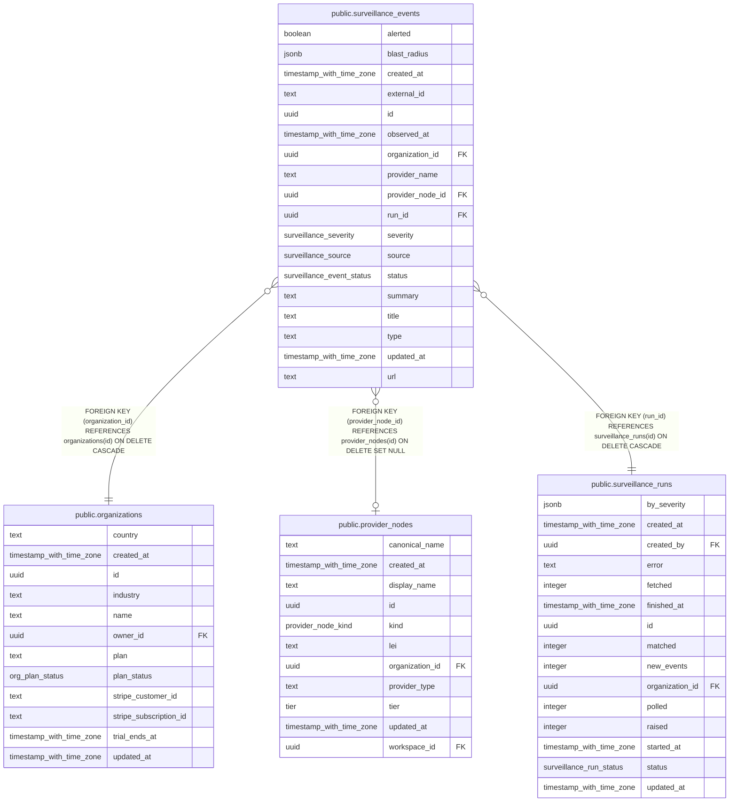

# public.surveillance_events

## Columns

| Name             | Type                      | Default                           | Nullable | Children | Parents                                                 | Comment |
| ---------------- | ------------------------- | --------------------------------- | -------- | -------- | ------------------------------------------------------- | ------- |
| alerted          | boolean                   | false                             | false    |          |                                                         |         |
| blast_radius     | jsonb                     | '{}'::jsonb                       | false    |          |                                                         |         |
| created_at       | timestamp with time zone  | now()                             | false    |          |                                                         |         |
| external_id      | text                      |                                   | false    |          |                                                         |         |
| id               | uuid                      | gen_random_uuid()                 | false    |          |                                                         |         |
| observed_at      | timestamp with time zone  |                                   | true     |          |                                                         |         |
| organization_id  | uuid                      |                                   | false    |          | [public.organizations](public.organizations.md)         |         |
| provider_name    | text                      | ''::text                          | false    |          |                                                         |         |
| provider_node_id | uuid                      |                                   | true     |          | [public.provider_nodes](public.provider_nodes.md)       |         |
| run_id           | uuid                      |                                   | false    |          | [public.surveillance_runs](public.surveillance_runs.md) |         |
| severity         | surveillance_severity     | 'low'::surveillance_severity      | false    |          |                                                         |         |
| source           | surveillance_source       |                                   | false    |          |                                                         |         |
| status           | surveillance_event_status | 'open'::surveillance_event_status | false    |          |                                                         |         |
| summary          | text                      | ''::text                          | false    |          |                                                         |         |
| title            | text                      | ''::text                          | false    |          |                                                         |         |
| type             | text                      | 'incident'::text                  | false    |          |                                                         |         |
| updated_at       | timestamp with time zone  | now()                             | false    |          |                                                         |         |
| url              | text                      | ''::text                          | false    |          |                                                         |         |

## Constraints

| Name                                                      | Type        | Definition                                                                      |
| --------------------------------------------------------- | ----------- | ------------------------------------------------------------------------------- |
| surveillance_events_organization_id_organizations_id_fk   | FOREIGN KEY | FOREIGN KEY (organization_id) REFERENCES organizations(id) ON DELETE CASCADE    |
| surveillance_events_pkey                                  | PRIMARY KEY | PRIMARY KEY (id)                                                                |
| surveillance_events_provider_node_id_provider_nodes_id_fk | FOREIGN KEY | FOREIGN KEY (provider_node_id) REFERENCES provider_nodes(id) ON DELETE SET NULL |
| surveillance_events_run_id_surveillance_runs_id_fk        | FOREIGN KEY | FOREIGN KEY (run_id) REFERENCES surveillance_runs(id) ON DELETE CASCADE         |

## Indexes

| Name                               | Definition                                                                                                                         |
| ---------------------------------- | ---------------------------------------------------------------------------------------------------------------------------------- |
| surveillance_events_dedup_idx      | CREATE UNIQUE INDEX surveillance_events_dedup_idx ON public.surveillance_events USING btree (organization_id, source, external_id) |
| surveillance_events_org_status_idx | CREATE INDEX surveillance_events_org_status_idx ON public.surveillance_events USING btree (organization_id, status)                |
| surveillance_events_pkey           | CREATE UNIQUE INDEX surveillance_events_pkey ON public.surveillance_events USING btree (id)                                        |
| surveillance_events_provider_idx   | CREATE INDEX surveillance_events_provider_idx ON public.surveillance_events USING btree (provider_node_id)                         |
| surveillance_events_run_idx        | CREATE INDEX surveillance_events_run_idx ON public.surveillance_events USING btree (run_id)                                        |

## Relations

---

> Generated by [tbls](https://github.com/k1LoW/tbls)
