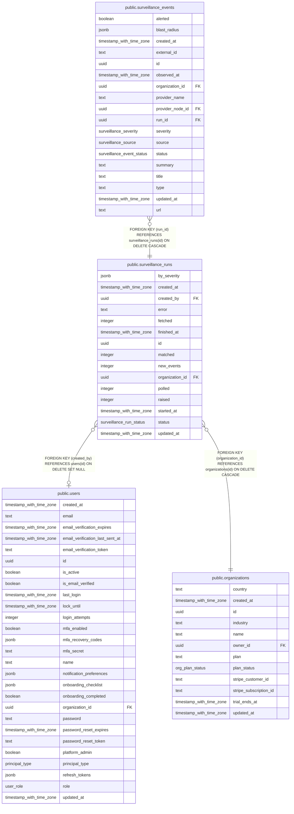

# public.surveillance_runs

## Columns

| Name            | Type                     | Default                           | Nullable | Children                                                    | Parents                                         | Comment |
| --------------- | ------------------------ | --------------------------------- | -------- | ----------------------------------------------------------- | ----------------------------------------------- | ------- |
| by_severity     | jsonb                    | '{}'::jsonb                       | false    |                                                             |                                                 |         |
| created_at      | timestamp with time zone | now()                             | false    |                                                             |                                                 |         |
| created_by      | uuid                     |                                   | true     |                                                             | [public.users](public.users.md)                 |         |
| error           | text                     | ''::text                          | false    |                                                             |                                                 |         |
| fetched         | integer                  | 0                                 | false    |                                                             |                                                 |         |
| finished_at     | timestamp with time zone |                                   | true     |                                                             |                                                 |         |
| id              | uuid                     | gen_random_uuid()                 | false    | [public.surveillance_events](public.surveillance_events.md) |                                                 |         |
| matched         | integer                  | 0                                 | false    |                                                             |                                                 |         |
| new_events      | integer                  | 0                                 | false    |                                                             |                                                 |         |
| organization_id | uuid                     |                                   | false    |                                                             | [public.organizations](public.organizations.md) |         |
| polled          | integer                  | 0                                 | false    |                                                             |                                                 |         |
| raised          | integer                  | 0                                 | false    |                                                             |                                                 |         |
| started_at      | timestamp with time zone |                                   | true     |                                                             |                                                 |         |
| status          | surveillance_run_status  | 'queued'::surveillance_run_status | false    |                                                             |                                                 |         |
| updated_at      | timestamp with time zone | now()                             | false    |                                                             |                                                 |         |

## Constraints

| Name                                                  | Type        | Definition                                                                   |
| ----------------------------------------------------- | ----------- | ---------------------------------------------------------------------------- |
| surveillance_runs_created_by_users_id_fk              | FOREIGN KEY | FOREIGN KEY (created_by) REFERENCES users(id) ON DELETE SET NULL             |
| surveillance_runs_organization_id_organizations_id_fk | FOREIGN KEY | FOREIGN KEY (organization_id) REFERENCES organizations(id) ON DELETE CASCADE |
| surveillance_runs_pkey                                | PRIMARY KEY | PRIMARY KEY (id)                                                             |

## Indexes

| Name                              | Definition                                                                                                           |
| --------------------------------- | -------------------------------------------------------------------------------------------------------------------- |
| surveillance_runs_org_created_idx | CREATE INDEX surveillance_runs_org_created_idx ON public.surveillance_runs USING btree (organization_id, created_at) |
| surveillance_runs_org_status_idx  | CREATE INDEX surveillance_runs_org_status_idx ON public.surveillance_runs USING btree (organization_id, status)      |
| surveillance_runs_pkey            | CREATE UNIQUE INDEX surveillance_runs_pkey ON public.surveillance_runs USING btree (id)                              |

## Relations

---

> Generated by [tbls](https://github.com/k1LoW/tbls)
