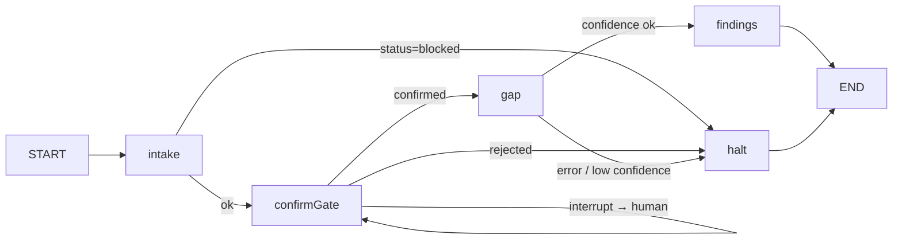

# Assessment orchestrator (RTV-78) — reproduction walkthrough

How the deterministic supervisor works and how to reproduce it from scratch: the **StateGraph**, the
**human-in-the-loop `interrupt()`**, and the **Postgres checkpointer** (durable, resumable runs).
Written to be followed **without an AI agent**. Decisions + rationale are in [`decisions.md`](./decisions.md).

---

## 1. The pieces (LangGraph-JS 1.x)

| Thing | Package / symbol | Role in this mission |
|---|---|---|
| State graph | `StateGraph`, `Annotation`, `START`, `END` (`@langchain/langgraph`) | the deterministic pipeline |
| Human gate | `interrupt(value)` + `Command({ resume })` (`@langchain/langgraph`) | pause for a person, then continue |
| Durability | `PostgresSaver` (`@langchain/langgraph-checkpoint-postgres`) | persist graph state; resume after a restart |
| In-memory (tests) | `MemorySaver` (`@langchain/langgraph`) | same API, no DB — for fast unit tests |

Install (this repo needs the flag — a pre-existing `zod` peer conflict):
```bash
npm install --legacy-peer-deps @langchain/langgraph @langchain/langgraph-checkpoint-postgres
```

## 2. The mental model



- A **node** is `async (state) => partialStateUpdate`. It returns only the fields it changes.
- An **edge** is either fixed (`addEdge`) or **data-conditional** (`addConditionalEdges(src, s => …, map)`).
  Routing reads `s.status` / `s.confirmed` — **data, never an LLM**.
- `interrupt(value)` inside a node **suspends** the whole graph and checkpoints it. The node function
  returns the resume value *on the next invoke*, not now.
- `compile({ checkpointer })` is what makes `interrupt`/resume and durability possible.

## 3. The minimal pattern (the shape, stripped of domain)

```ts
import { StateGraph, START, END, Annotation, interrupt, Command, MemorySaver } from '@langchain/langgraph';

const State = Annotation.Root({
  confirmed: Annotation<boolean>,
  status: Annotation<'running' | 'waiting_human' | 'blocked' | 'done'>,
});

const graph = new StateGraph(State)
  .addNode('gate', async () => {
    const decision = interrupt<{ ask: string }, { confirmed: boolean }>({ ask: 'approve?' });
    return { confirmed: decision.confirmed };          // runs only AFTER resume
  })
  .addNode('work', async () => ({ status: 'done' as const }))
  .addNode('halt', async () => ({ status: 'blocked' as const }));

graph.addEdge(START, 'gate');
graph.addConditionalEdges('gate', s => (s.confirmed ? 'work' : 'halt'), { work: 'work', halt: 'halt' });
graph.addEdge('work', END);
graph.addEdge('halt', END);

const app = graph.compile({ checkpointer: new MemorySaver() });
const config = { configurable: { thread_id: 'run-1' } };

await app.invoke({ status: 'running', confirmed: false }, config); // runs to the interrupt, then returns
// → getState shows a pending interrupt; the run is suspended
await app.invoke(new Command({ resume: { confirmed: true } }), config); // continues from the checkpoint → done
```

**Key facts to remember (all `[verified]` in this repo):**
- `invoke` **resolves** when it hits an `interrupt()` (it does not throw); the pause shows up in
  `getState(config).tasks[].interrupts`.
- You **resume** by invoking again with `new Command({ resume: <value> })` and the **same `thread_id`**.
- `interrupt()` **requires a checkpointer** — compiling without one and calling `interrupt` fails.

## 4. Map to the real code

| File | What to look at |
|---|---|
| `services/orchestrator/assessmentGraph.ts` | the real graph: `intake → confirmGate (interrupt) → gap → findings` + `halt`; `AssessmentGraphDeps` injected; `buildAssessmentGraph(deps, checkpointer)` |
| `services/orchestrator/assessmentOrchestrator.ts` | prod wiring: `new PostgresSaver(getPool())` + `.setup()`, the `assessment_runs` row, `startAssessmentRun` / `resumeAssessmentRun`, per-run Langfuse trace |
| `db/schema/assessmentRuns.ts` + `enums.ts` | the `assessment_runs` table + `assessment_run_status` (running\|waiting_human\|blocked\|done) |
| `routes/assessmentRunRoutes.ts` + `controllers/assessmentRunController.ts` | `POST /api/v1/assessment-runs`, `GET`, `POST /:id/resume` |

Production swaps `MemorySaver` for `PostgresSaver` and `thread_id` is the `assessment_runs.id`.

## 5. The run lifecycle (what you'd demo)

1. **Start:** `POST /api/v1/assessment-runs { arrangementId }` → a run row (`status=running`), the graph
   runs intake, then **suspends at the gate** → `status=waiting_human`, response `{ waiting: true,
   interrupt: { type: 'confirm_arrangement', arrangement } }`.
2. **Approve:** `POST /api/v1/assessment-runs/:id/resume { confirmed: true }` → the graph continues from
   the checkpoint, runs the gap assessment, finalises → `status=done`.
3. **Reject / low confidence:** `{ confirmed: false }`, or a gap result below `minConfidence` → the run
   ends `status=blocked`; nothing is written as authoritative.

## 6. Durability — the "kill → resume" proof

Because state lives in the Postgres checkpoint (not memory), a **restarted process resumes mid-run**.
The L2 test proves it: run to the interrupt with one `PostgresSaver`, then build a **brand-new**
`PostgresSaver` on the same DB and resume the **same `thread_id`** — it continues from the checkpoint.
`[verified]`

```bash
# needs Docker (testcontainers spins a real postgres:16-alpine); DATABASE_URL in CI
npx vitest run tests/integrationtest/assessmentGraph.integration.test.ts
# → 6 passed: run→interrupt, resume→done, kill→resume, reject→blocked, low-confidence→blocked, migration applied
```

## 7. Common mistakes & troubleshooting

| Symptom | Cause | Fix |
|---|---|---|
| `interrupt()` throws / no suspend | graph compiled **without** a checkpointer | pass `compile({ checkpointer })` |
| resume starts a new run instead of continuing | different `thread_id` on the resume `invoke` | reuse the **same** `thread_id` (the run id) |
| `npm install` fails with `ERESOLVE` | pre-existing `zod` peer conflict (not yours) | `--legacy-peer-deps` (CI already uses it) |
| CI "non-drift mount guard" fails after adding a route | new router not registered | add it to `openapi/mounts.ts` (see that file's header) |
| CI "Schema ERD drift-check" fails after a schema change | committed `docs/data-model` is stale | regenerate: apply migrations to a `postgres:17.4`, run the **pinned** tbls image `doc -t mermaid --sort -j <dsn> docs/data-model --force`, commit the result |
| run won't advance past the gate | waiting on a human; no resume was sent | `POST /:id/resume { confirmed }` |

## 8. Why it's shaped this way (one line)

Deterministic routing + a human gate + a durable checkpoint = an **auditable, resumable, human-accountable**
pipeline — the DORA / EU-AI-Act defensibility, not a GPT wrapper. Full rationale: [`decisions.md`](./decisions.md).
